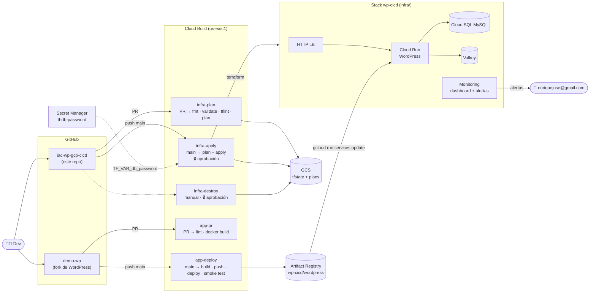

# WordPress en GCP con CI/CD (Terraform + Cloud Build)

Misma infraestructura que `iacode-wp-gcp2`: VPC con PSA y NAT, Cloud SQL MySQL, Memorystore Valkey, Cloud Run v2 y un HTTP LB. A diferencia de ese repo, aquí:

- Terraform se ejecuta desde **Cloud Build**: en cada PR hace `plan` y en `main` hace `apply`, que requiere aprobación.
- El estado vive en **GCS** y la contraseña de la BD en **Secret Manager**.
- WordPress sale de **[`enrique-jose/demo-wp`](https://github.com/enrique-jose/demo-wp)**, un fork de WordPress con su propio pipeline, que construye la imagen y despliega una revisión nueva en Cloud Run.
- La **observabilidad** está declarada como código: un dashboard y alertas por email, agrupados en Backend y Bases de datos.

| | |
|---|---|
| Proyecto | `cool-academy-489503-f3` |
| Región | `us-east1` |
| Prefijo de recursos | `wp-cicd` (para no chocar con `wordpress-community` de `iacode-wp-gcp2`) |

## Arquitectura



Terraform crea el servicio de Cloud Run, pero **ignora los cambios de imagen** (`lifecycle.ignore_changes`). La imagen la gestiona el pipeline de `demo-wp`, así que un `apply` de infra no deshace un deploy de la app.

## Estructura

```
bootstrap/          # se aplica UNA vez en local: bucket de estado, AR, secret, SAs, repos y triggers
infra/
  backend.tf        # estado en gs://cool-academy-489503-f3-tfstate/wordpress
  env/prod.tfvars   # valores del entorno (sin secretos)
  cloudbuild/       # infra-plan.yaml · infra-apply.yaml · infra-destroy.yaml
  modules/
    networking/ database/ cache/ cloudrun/   # igual que iacode-wp-gcp2 (+ variables nuevas)
    monitoring/                              # dashboard, uptime check, log metrics y alertas
```

## Puesta en marcha (una sola vez)

1. **Conexión con GitHub.** Ve a *Cloud Build → Repositories (2nd gen) → Create host connection → GitHub*, en la región `us-east1` y con el nombre `github`. Autoriza la GitHub App de Cloud Build y dale acceso a `iac-wp-gcp-cicd` y `demo-wp`. Este paso necesita OAuth en el navegador, por eso no está en Terraform.
2. **Bootstrap:**
   ```bash
   cd bootstrap
   cp terraform.tfvars.example terraform.tfvars
   gcloud auth application-default login
   terraform init && terraform apply
   ```
   Guarda bien `bootstrap/terraform.tfstate`. Es local y está fuera de git.
3. **Primer despliegue de la infra.** Abre un PR que toque `infra/`. `infra-plan` publica el plan, y al hacer merge `infra-apply` queda esperando aprobación:
   ```bash
   gcloud builds list --region us-east1 --filter='status=PENDING'
   gcloud builds approve <BUILD_ID> --region us-east1
   ```
   El primer apply tarda entre 20 y 30 min, sobre todo por Cloud SQL y Valkey. Arranca con la imagen oficial `wordpress:latest`.
4. **Primer deploy de la app.** Haz merge en `main` de `demo-wp`, o ejecuta el trigger a mano:
   ```bash
   gcloud builds triggers run wp-cicd-app-deploy --region us-east1 --branch main
   ```

## Triggers

| Trigger | Repo | Evento | Config | Aprobación |
|---|---|---|---|---|
| `wp-cicd-infra-plan` | iac-wp-gcp-cicd | PR → `main` (`infra/**`) | `infra/cloudbuild/infra-plan.yaml` | — |
| `wp-cicd-infra-apply` | iac-wp-gcp-cicd | push `main` (`infra/**`) | `infra/cloudbuild/infra-apply.yaml` | **sí** |
| `wp-cicd-infra-destroy` | iac-wp-gcp-cicd | manual, `_CONFIRM=destroy` | `infra/cloudbuild/infra-destroy.yaml` | **sí** |
| `wp-cicd-app-pr` | demo-wp | PR → `main` | `cloudbuild.yaml` (`_DEPLOY=false`) | — |
| `wp-cicd-app-deploy` | demo-wp | push `main` | `cloudbuild.yaml` (`_DEPLOY=true`) | — |

Service accounts:

- **`wp-cicd-tf`**: lo usan los triggers de infra. Tiene los roles de administración de cada servicio del stack y acceso de escritura solo al bucket de estado.
- **`wp-cicd-app`**: lo usan los triggers de la app. Puede escribir en AR, tiene `run.developer` y puede actuar como el SA de Cloud Run (solo ese SA).

El plan de cada PR queda en `gs://cool-academy-489503-f3-tfstate/plans/pr-<n>/<sha>/plan.txt`, donde se borra a los 30 días.

## Observabilidad

El dashboard se llama **`wp-cicd · WordPress`**. Su URL sale con `terraform output dashboard_url`. Está organizado en grupos plegables:

| Grupo | Contenido |
|---|---|
| Resumen | uptime, req/s, p95, instancias, conexiones y CPU de la BD |
| Incidentes | alertas abiertas |
| Backend · Load Balancer | req/s por clase de respuesta, ratio 5xx, latencia p50/p95 y latencia de backend |
| Backend · Cloud Run | req/s, latencia p95/p99, instancias, CPU, memoria, startup, concurrencia y PHP fatal errors |
| Backend · Logs | logs de Cloud Run con severidad ERROR o superior |
| Bases de datos · Cloud SQL | up, CPU, memoria, disco, conexiones, queries, IOPS y red |
| Bases de datos · Cloud SQL logs | logs de Cloud SQL con severidad WARNING o superior |
| Bases de datos · Valkey | hit ratio, memoria, CPU, clientes, claves, evictions y expirations |

### Alertas

Todas llegan por email a `alert_emails`. Llevan las etiquetas `category` (`backend` o `database`), `component` y `severity`, y un runbook en la descripción.

| Categoría | Alerta | Condición | Severidad |
|---|---|---|---|
| Backend | Sitio caído | uptime check falla en 2 o más regiones durante 2 min | critical |
| Backend | Ratio 5xx del LB | > 5 % durante 5 min | critical |
| Backend | Latencia p95 de Cloud Run | > 2000 ms durante 10 min | warning |
| Backend | Cloud Run en el máximo de instancias | >= `run_max_instances` durante 10 min | warning |
| Backend | Memoria de Cloud Run | p99 > 85 % durante 5 min | warning |
| Backend | PHP fatal errors | > 5 en 5 min | warning |
| Backend | Build de Cloud Build fallido | log `ERROR` en un build | warning |
| DB | Cloud SQL caída | `up` < 1 durante 3 min | critical |
| DB | CPU de Cloud SQL | > 80 % durante 10 min | warning |
| DB | Memoria de Cloud SQL | > 90 % durante 10 min | warning |
| DB | Disco de Cloud SQL | > 85 % | warning |
| DB | Conexiones de Cloud SQL | > 80 % de `max_connections` durante 5 min | critical |
| DB | Fallo de backup | log de error de backup | critical |
| DB | Memoria de Valkey | > 85 % durante 10 min | warning |
| DB | Hit ratio de Valkey | < 70 % durante 30 min, con más de 1 lookup/s | warning |

Los umbrales son variables del módulo `monitoring`. Para silenciar una alerta durante un mantenimiento:

```bash
gcloud monitoring snoozes create --display-name="mantenimiento" \
  --criteria-policies=<POLICY_ID> --start-time=now --end-time=+2h
```

## Notas heredadas de `iacode-wp-gcp2`

- Cloud SQL usa un sufijo aleatorio, porque un nombre borrado no se puede reutilizar durante unos 7 días.
- La conexión de PSA usa `deletion_policy = "ABANDON"`.
- **Destroy:** Cloud Run retiene las IPs de la subred `public` durante 1 o 2 h. El provisioner de destroy espera a que se liberen, y por eso `infra-destroy` usa la imagen de `gcloud` con un timeout de 4 h.
- `wp-content/uploads` es efímero en Cloud Run. Para producción, móntalo sobre un bucket GCS.
