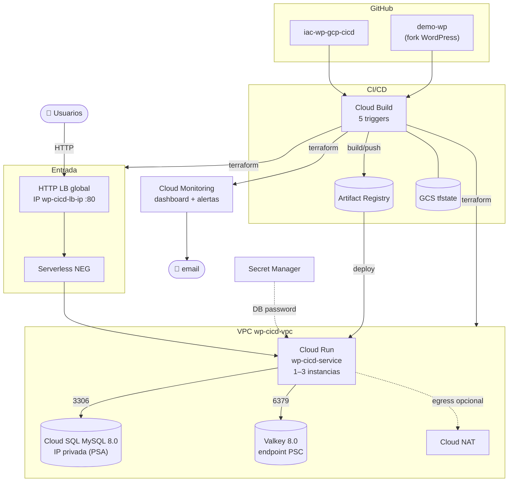

# 1. Architecture

## Visión general

WordPress se ejecuta en **Cloud Run** detrás de un **HTTP Load Balancer** global. Los datos viven en **Cloud SQL MySQL**, y el object cache en **Memorystore for Valkey**. Las dos bases de datos solo son accesibles por IP privada dentro de la VPC.

Todo se despliega con **Terraform** desde **Cloud Build**, a partir de dos repositorios de GitHub:

- `iac-wp-gcp-cicd`, para la infraestructura;
- `demo-wp`, para la aplicación, que es un fork de WordPress.

## Componentes

| Capa | Servicio | Recurso | Documento |
|---|---|---|---|
| Entrada | External Application LB (HTTP) | `wp-cicd-http` y `wp-cicd-backend` | [Infrastructure](2-Infrastructure.md) |
| Cómputo | Cloud Run v2 | `wp-cicd-service` | [Infrastructure](2-Infrastructure.md), [Application](4-Application.md) |
| Datos | Cloud SQL MySQL 8.0 | `wp-cicd-db-<sufijo>` | [Data](5-Data.md) |
| Cache | Memorystore for Valkey 8.0 | `wp-cicd-valkey` | [Data](5-Data.md) |
| Red | VPC, subredes, PSA, PSC y NAT | `wp-cicd-vpc` | [Infrastructure](2-Infrastructure.md) |
| Secretos | Secret Manager | `wp-cicd-db-password` y `wp-cicd-tf-db-password` | [Security](6-Security.md) |
| CI/CD | Cloud Build y Artifact Registry | triggers `wp-cicd-*` | [CI/CD](3-Ci-cd.md) |
| Observabilidad | Cloud Monitoring y Logging | dashboard `wp-cicd · WordPress` | [Observability](7-Observability.md) |

## Flujo de una petición

1. El usuario entra por la IP global del Load Balancer, en el puerto 80.
2. El backend service enruta la petición a Cloud Run a través de una serverless NEG. Cloud Run tiene `ingress = INGRESS_TRAFFIC_INTERNAL_LOAD_BALANCER`, así que solo acepta tráfico que venga del LB.
3. WordPress sale a la VPC por la subred `public` mediante Direct VPC egress, con el network tag `wp-cicd-run`.
4. Lee y escribe en Cloud SQL por IP privada (PSA, puerto 3306).
5. Consulta el object cache en Valkey a través del endpoint PSC de la subred `private` (puerto 6379).
6. Las reglas de firewall de egress solo dejan pasar el tráfico 3306 y 6379 que lleva el tag de Cloud Run.

## Decisiones de diseño

| Decisión | Motivo |
|---|---|
| **Dos repos** (infra y app) | Ciclos de vida distintos: la infra cambia poco y con aprobación, la app cambia a menudo y se despliega sola |
| **Terraform crea Cloud Run, pero ignora la imagen y el tráfico** (`ignore_changes`) | El pipeline de `demo-wp` es el dueño de las revisiones. Así un `apply` de infra no deshace un deploy ni un rollback |
| **`bootstrap/` fuera de `infra/`** | Crea el bucket de estado y los SAs que usa el propio pipeline. Si `infra` se gestionara a sí mismo, podría quitarse sus propios permisos |
| **Fork del mirror `WordPress/WordPress`** | Código ya compilado: no hace falta `npm build` y se sincroniza por tags de release |
| **Imagen oficial `wordpress` como base** | Reutiliza el entrypoint, que genera `wp-config.php` desde variables de entorno |
| **Un solo entorno** (`env/prod.tfvars`) | Alcance actual. Para añadir otro entorno: un `.tfvars` y un prefijo nuevos, y triggers por rama o tag |
| **Prefijo `wp-cicd`** | Convive en el mismo proyecto con el stack `wordpress-community` de `iacode-wp-gcp2` |
| **Pool por defecto de Cloud Build** | Terraform solo habla con las APIs de Google, así que no hace falta un private pool |

## Relación con `iacode-wp-gcp2`

La IaC es la misma. Los cambios están en [Infrastructure → Diferencias con iacode-wp-gcp2](2-Infrastructure.md#diferencias-con-iacode-wp-gcp2).
