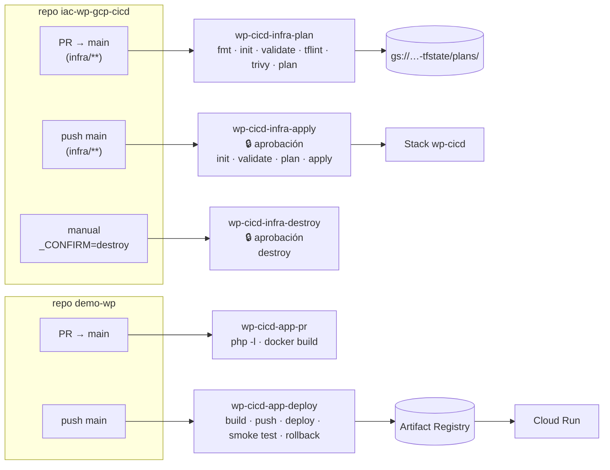

# 3. CI/CD

## Visión general



## Bootstrap (`bootstrap/`)

Es el stack que prepara el CI/CD. Se aplica **una vez, en local**, con credenciales de owner, y su estado se queda en local en `bootstrap/terraform.tfstate`, fuera de git.

| Recurso | Nombre | Uso |
|---|---|---|
| APIs | cloudbuild, artifactregistry, secretmanager, iam, cloudresourcemanager, serviceusage y storage | — |
| Bucket | `cool-academy-489503-f3-tfstate` | Estado de `infra/` (con versionado, se conservan 20 versiones) y planes de PR (se borran a los 30 días) |
| Artifact Registry | `us-east1-docker.pkg.dev/cool-academy-489503-f3/wp-cicd` | Imágenes de `demo-wp`. Conserva las 20 últimas y borra las imágenes sin tag de más de 14 días |
| Secret | `wp-cicd-tf-db-password` | Contraseña de la BD (`random_password`, 24 caracteres) |
| SA | `wp-cicd-tf` y `wp-cicd-app` | Ver [Security](6-Security.md#service-accounts) |
| Repos | `iac-wp-gcp-cicd` y `demo-wp` | Sobre la conexión 2nd gen `github` (us-east1) |
| Triggers | 5, ver la tabla siguiente | — |
| Aprobadores | `roles/cloudbuild.builds.approver` | `egonzalez@sequentia.co` |

### Puesta en marcha desde cero

1. **Conexión con GitHub** (consola, una vez): *Cloud Build → Repositories → 2nd gen → Create host connection → GitHub*, en la región `us-east1` y con el nombre `github`. Instala la GitHub App en `enrique-jose` con acceso a los dos repos.
2. Ejecuta el bootstrap:
   ```bash
   cd bootstrap
   cp terraform.tfvars.example terraform.tfvars   # revisar valores
   gcloud auth application-default login
   terraform init && terraform apply
   ```
3. PR en `iac-wp-gcp-cicd` → `infra-plan` → merge → aprobar `infra-apply` (entre 20 y 30 min la primera vez).
4. PR en `demo-wp` → `app-pr` → merge → `app-deploy`.

## Triggers

| Trigger | Repo | Evento | Config | SA | Aprobación |
|---|---|---|---|---|---|
| `wp-cicd-infra-plan` | iac-wp-gcp-cicd | PR → `main`, `infra/**` | `infra/cloudbuild/infra-plan.yaml` | wp-cicd-tf | — |
| `wp-cicd-infra-apply` | iac-wp-gcp-cicd | push `main`, `infra/**` | `infra/cloudbuild/infra-apply.yaml` | wp-cicd-tf | **sí** |
| `wp-cicd-infra-destroy` | iac-wp-gcp-cicd | manual | `infra/cloudbuild/infra-destroy.yaml` | wp-cicd-tf | **sí** |
| `wp-cicd-app-pr` | demo-wp | PR → `main` | `cloudbuild.yaml` (`_DEPLOY=false`) | wp-cicd-app | — |
| `wp-cicd-app-deploy` | demo-wp | push `main` | `cloudbuild.yaml` (`_DEPLOY=true`) | wp-cicd-app | — |

Los cambios que solo tocan `docs/`, `bootstrap/` o `README.md` **no** disparan los triggers de infra.

Las substitutions las define el bootstrap:
- **Infra:** `_TF_VERSION=1.16.6`, `_STATE_BUCKET`, `_TFVARS=env/prod.tfvars` y `_DB_SECRET`.
- **App:** `_REGION`, `_AR_REPO`, `_SERVICE=wp-cicd-service`, `_LB_IP=wp-cicd-lb-ip` y `_DEPLOY`.

## Pipelines de infraestructura

### `infra-plan.yaml` (PR)

| Paso | Imagen | Qué hace |
|---|---|---|
| fmt | `hashicorp/terraform` | `fmt -check -recursive -diff` |
| init | `hashicorp/terraform` | `init` con el backend GCS |
| validate | `hashicorp/terraform` | `validate` |
| tflint | `ghcr.io/terraform-linters/tflint:v0.53.0` | Preset `recommended` y ruleset `google` (`infra/.tflint.hcl`). **Bloquea** el PR |
| trivy | `aquasec/trivy:0.56.2` | `config` con severidad HIGH y CRITICAL. Es **informativo**, no bloquea |
| plan | `hashicorp/terraform` | `plan -lock=false -out=tfplan`; el resultado se guarda en `plan.txt` y se sube a GCS |

`-lock=false` sirve para que un plan de PR nunca bloquee un apply que esté en marcha sobre `main`.

### `infra-apply.yaml` (main)

`init` → `validate` → `plan -out=tfplan` → `apply tfplan` → `output`. Vuelve a planificar sobre `main`, porque el plan del PR puede estar desactualizado, y aplica exactamente ese plan. El timeout es de 1 h.

### `infra-destroy.yaml` (manual)

```bash
gcloud builds triggers run wp-cicd-infra-destroy --region us-east1 \
  --branch main --substitutions _CONFIRM=destroy
```

Se niega a ejecutarse si no recibe `_CONFIRM=destroy`, y además requiere aprobación. Usa la imagen `google-cloud-cli` e instala Terraform en el propio paso, con un timeout de 4 h para cubrir la espera de las IPs serverless.

Desde la consola: *Cloud Build → Triggers → `wp-cicd-infra-destroy` → Run*. El formulario ya muestra la variable `_CONFIRM` con el valor `no`; cámbialo por `destroy`. Con cualquier otro valor, el build termina en FAILURE con `Refusing to destroy` sin tocar nada.

## Pipeline de la aplicación (`demo-wp/cloudbuild.yaml`)

| Paso | En PR | En main |
|---|---|---|
| `php-lint`: `php -l` sobre `wp-content/` | ✅ | ✅ |
| `build`: `docker build` con caché de `:main` | ✅ | ✅ |
| `push`: `:SHORT_SHA` y `:main` a AR | — | ✅ |
| `deploy`: `gcloud run services update --image …@sha256:…` y `update-traffic --to-latest` | — | ✅ |
| `smoke-test`: `curl -L http://<IP LB>/wp-login.php`, 18 intentos cada 10 s | — | ✅ |

**Rollback automático:** si el smoke test falla, el pipeline ejecuta `update-traffic --to-revisions=<revisión anterior>=100` y el build termina en `FAILURE`. En el siguiente deploy, `--to-latest` devuelve el tráfico a la revisión nueva.

## Aprobar un build

```bash
gcloud builds list --region us-east1 --filter='status=PENDING'
gcloud builds approve <BUILD_ID> --region us-east1
```

También se puede desde la consola: *Cloud Build → Historial → build → **Aprobar***. El aprobador tiene que ser una cuenta de la organización. La org policy `iam.allowedPolicyMemberDomains` rechaza cuentas externas como `@gmail.com`.

## Rollback manual

```bash
# Revisiones disponibles
gcloud run revisions list --service wp-cicd-service --region us-east1
# Enviar el 100 % del tráfico a una revisión concreta
gcloud run services update-traffic wp-cicd-service --region us-east1 \
  --to-revisions=<REVISION>=100
```

Para la infra, haz revert del commit en `main` (con un PR), haz merge y aprueba el apply.

## Problemas conocidos

| Síntoma | Causa y solución |
|---|---|
| `tflint` falla con `terraform_required_version` / `required_providers` | Cada módulo necesita su `versions.tf` |
| `NOT_FOUND: connections/github` en el bootstrap | La conexión de GitHub no existe todavía o tiene otro nombre o región |
| `allowedPolicyMemberDomains` al añadir aprobadores | Solo se admiten cuentas de la organización |
| `app-deploy` falla con `iam.serviceaccounts.actAs denied` | `wp-cicd-app` no puede actuar como `wp-cicd-run`. Comprueba que `app_deployer_service_account` está en `env/prod.tfvars` y que el apply de infra se ejecutó (crea el binding `serviceAccountUser` sobre el SA) |
| `app-deploy` falla con `Service not found` | Se hizo merge en `demo-wp` antes del primer `infra-apply`. Relánzalo con `gcloud builds triggers run wp-cicd-app-deploy --region us-east1 --branch main` |
| `Error acquiring the state lock` | Hay otro apply en curso. Espera, o si el build murió, ejecuta `terraform force-unlock <LOCK_ID>` en local |
